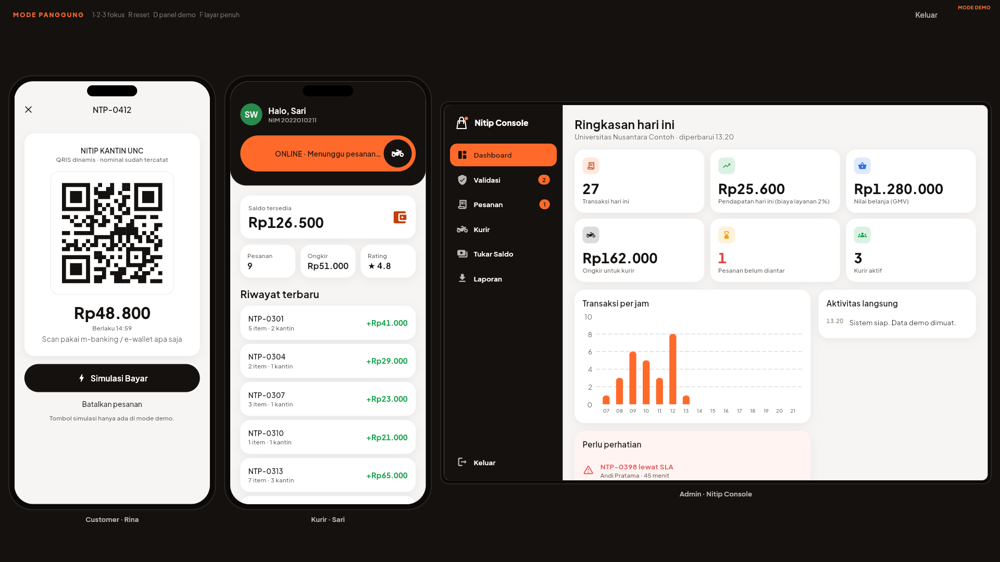
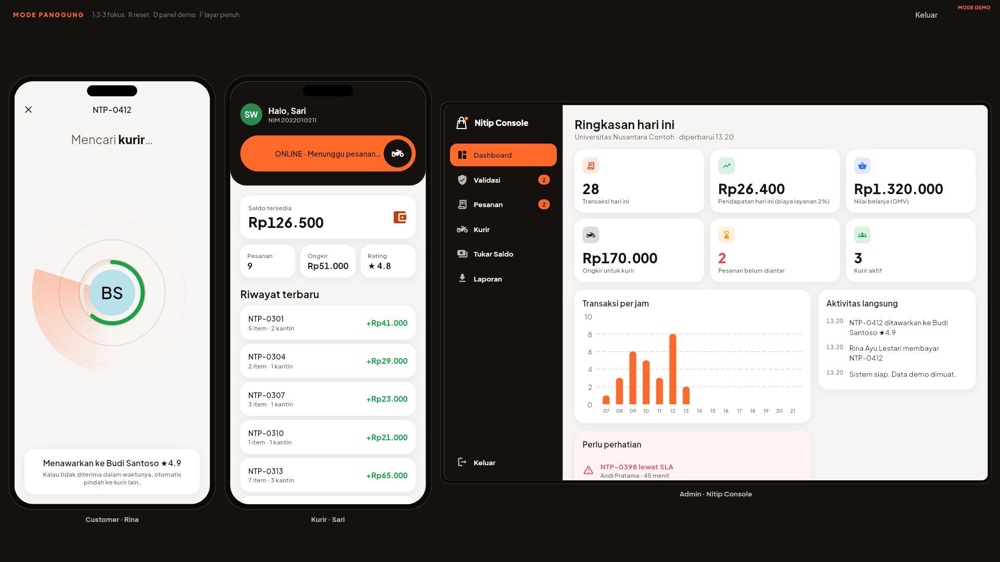
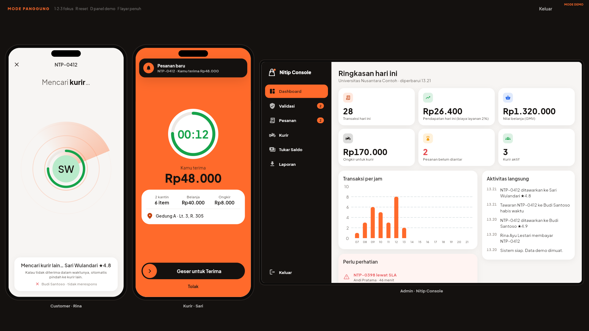
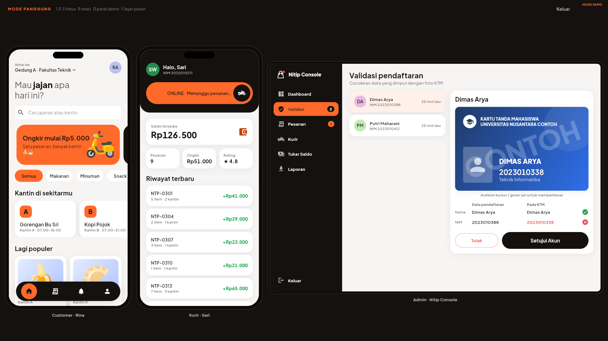

# Nitip — Prototype Aplikasi Kantin Kampus

> **Kuliah jalan, jajan datang.** Prototype Flutter untuk presentasi ke klien: pesan jajanan dari banyak kantin
> kampus, dikirim kurir sesama mahasiswa. **Semua data simulasi — tidak ada backend, pembayaran palsu.**
> Badge **MODE DEMO** selalu tampil.

Satu codebase menghasilkan:

| Output | Isi | Cara dapat |
|---|---|---|
| **APK Android** | Customer + Kurir + Admin dalam satu aplikasi (pilih peran di awal) | Artifact `nitip-apk` di GitHub Actions |
| **Web** | Sama, plus **Mode Panggung** (3 panel berdampingan) dan Admin versi layar lebar | Artifact `nitip-web` / Vercel (lihat di bawah) |

## Cara pakai demo

1. Buka aplikasi → pilih peran. Di web layar lebar (≥ 1280 px) ada **Mode Panggung**: HP Customer, HP Kurir, dan
   Dashboard Admin sekaligus, state-nya dibagi live (aksi di satu panel langsung terlihat di panel lain).
2. **Tekan lama badge MODE DEMO** → **Panel Demo**: reset data, timeout tawaran kurir (15/60 dtk), perilaku kurir bot,
   auto-pilot Sari, kecepatan waktu, picu order masuk, lompat ke tahap tertentu, suara/haptik, pindah peran.
3. Mode Panggung: `1`/`2`/`3` fokus panel · `R` reset · `D` Panel Demo · `F` layar penuh.
4. Akun demo: tombol **"Pakai akun demo"** di tiap layar masuk.

Naskah presentasi lengkap (±12 menit): [`docs/DEMO_SCRIPT.md`](docs/DEMO_SCRIPT.md).

## Cuplikan (Mode Panggung, hasil QA di browser)

| | |
|---|---|
|  |  |
| QRIS dinamis Rp48.800 | Radar cari kurir; Admin live |
|  |  |
| Budi timeout → order masuk ke Sari | Validasi KTM (NIM tidak cocok ditandai merah) |

Semua screenshot: [`docs/screenshots/`](docs/screenshots/).

## Mengambil APK

- **Dari CI:** GitHub Actions → workflow *CI* → artifact `nitip-apk` (`app-release.apk`, ditandatangani debug key — cukup untuk sideload/demo).
- **Build lokal:** `flutter build apk --release` → `build/app/outputs/flutter-apk/app-release.apk`.
- Aktifkan "Install dari sumber tidak dikenal" di HP, lalu buka file APK. **Belum diuji di perangkat nyata** — lihat `docs/PROGRESS.md`.

## Yang diperagakan (sesuai brief)

- Daftar + upload KTM → admin validasi (KTM berdampingan dengan data, kaca pembesar) → notifikasi akun aktif
- Belanja multi-kantin: **maks 20 item**, ongkir bertingkat (1–5 → Rp5.000, 6–10 → Rp8.000, 11–20 → Rp12.000),
  **biaya layanan 2%**
- QRIS dinamis (nominal tercatat di QR) + tombol *Simulasi Bayar*
- Dispatch kurir: rating tertinggi dulu; tidak diterima dalam waktunya → otomatis pindah ke kurir lain
- Kurir: terima/tolak, detail per kantin, checklist belanja, timer, serahkan → saldo masuk → tukar saldo
- Admin: transaksi & pendapatan hari ini, status pesanan, kurir on-progress (WhatsApp/telepon/batalkan),
  rekap kurir, laporan **Excel**

## Asumsi bisnis (perlu dikonfirmasi klien)

| # | Asumsi | Default |
|---|---|---|
| A1 | Biaya layanan 2% dihitung dari… | **subtotal** (tanpa ongkir). Bisa diubah: `Pricing.feeIncludesShipping` |
| A2 | Maks 20 item | total qty seluruh item lintas kantin |
| A3 | Ongkir | tetap per transaksi walau banyak kantin |
| A4 | Kurir menalangi belanja di kantin, lalu menerima subtotal + ongkir ke saldo | ya |
| A5 | Biaya layanan 2% | pendapatan platform/owner |
| A6 | Tukar saldo | diproses manual oleh admin (setujui → tandai dibayar) |
| A7 | Tidak ada kurir tersedia | status "Belum ada kurir" + tombol *Coba lagi* |
| A8 | SLA antar | 30 menit sejak kurir menerima (lewat = merah di admin) |

## Yang BELUM ada di prototype ini

Backend & database · payment gateway QRIS sungguhan (Xendit/Midtrans) · notifikasi server (FCM) ·
timer dispatch di server · email/WhatsApp sungguhan · OCR KTM · peta/GPS sungguhan · rilis Play Store.
Foto makanan masih placeholder emoji bergradasi.

## Pengembangan

```bash
flutter pub get
flutter analyze
flutter test                       # unit (aturan harga/dispatch/saldo) + widget e2e ketiga peran
flutter run -d chrome              # atau: flutter run -d web-server --web-port 8080
flutter build web --release
flutter build apk --release        # butuh Android SDK
```

Struktur: `lib/domain` (aturan murni + test) · `lib/data` (`Backend` palsu in-memory, seed) ·
`lib/core` (design system, motion, brand) · `lib/features/{customer,courier,admin}` · `lib/demo` (Panel Demo,
Mode Panggung, notifikasi). Detail: [`docs/PLAN.md`](docs/PLAN.md), [`docs/SCREENS.md`](docs/SCREENS.md),
[`docs/MOTION.md`](docs/MOTION.md), [`docs/DESIGN.md`](docs/DESIGN.md).

Regenerasi aset: `python3 tool/gen_sfx.py` (SFX) · `python3 tool/gen_icons.py assets/brand` (ikon) ·
`dart run flutter_launcher_icons` · splash native: lihat komentar di `pubspec.yaml`.

## Deploy web ke Vercel

Workflow `.github/workflows/deploy-web.yml` membangun web lalu `vercel deploy --prebuilt --prod`.
Buat project di Vercel, lalu set secret GitHub: `VERCEL_TOKEN`, `VERCEL_ORG_ID`, `VERCEL_PROJECT_ID`.
Tanpa secret, build tetap jalan dan hasilnya tersedia sebagai artifact (unggah manual).
`vercel.json` meneruskan semua path ke `index.html` (SPA) supaya `/stage` dan `/admin` bisa dibuka langsung.

## Catatan

- Prototype ini bukan produk jadi: sebagian besar pekerjaan sebenarnya (backend, payment, dispatch server-side,
  saldo & laporan) ada di balik layar.
- Desain terinspirasi dua referensi Behance (Cravk, Insightlancer) hanya sebagai arah gaya; tidak ada aset yang disalin.
  KTM pada demo adalah gambar buatan sendiri dengan watermark "CONTOH".
